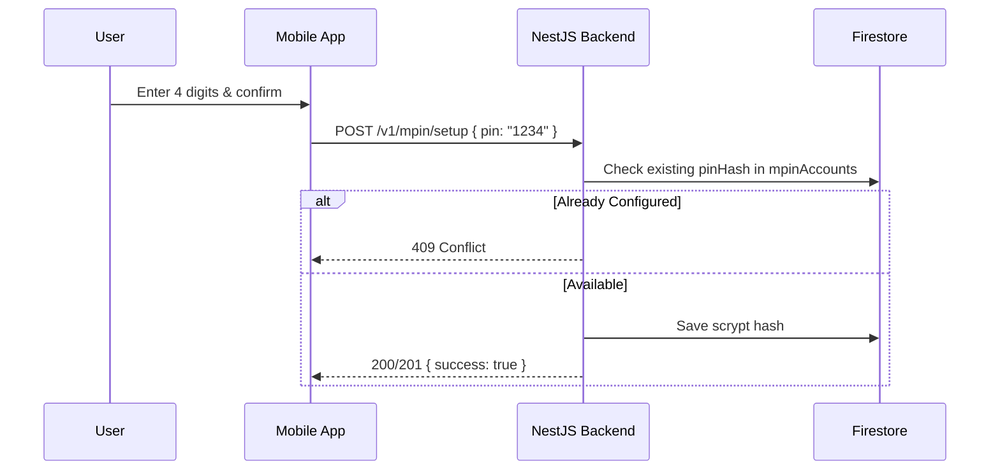
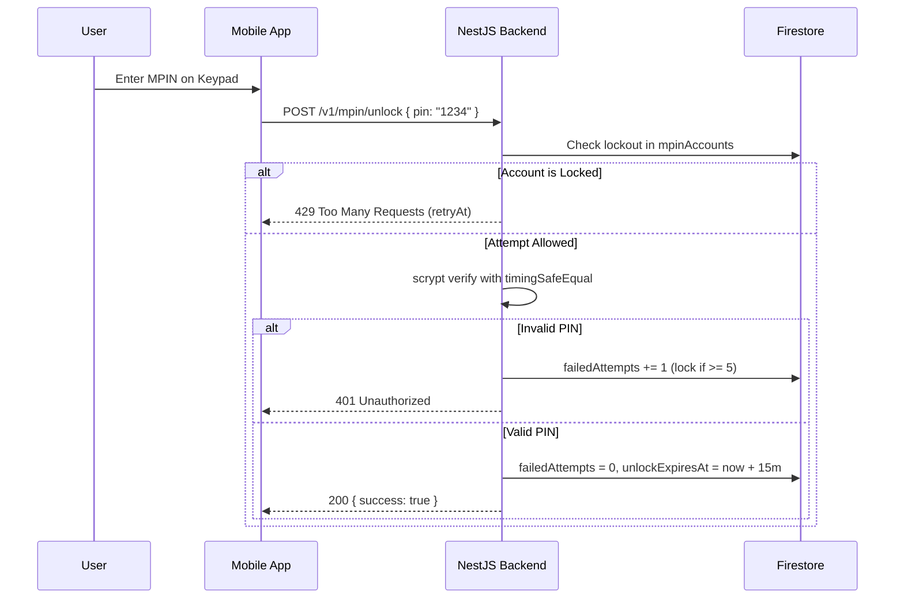

# RideGuard MPIN Architecture & Integration Guide

This document defines the backend implementation, security controls, and frontend integration contracts for the RideGuard 4-Digit Mobile Personal Identification Number (MPIN) system.

---

## 1. Architecture & Division of Responsibility

| Component | Responsibility |
| --------- | -------------- |
| **Frontend (`rideguard-ui`)** | Numeric keypad input (`PinPad`), masked digit indicators, step coordination (`/mpin/[step]`), memory-only grant draft storage (`mpin.store.ts`), application gatekeeper (`MpinAppGate`), background privacy cover. |
| **Backend (`rideguard-node`)** | Authenticated identity verification (`FirebaseAuthGuard`), scrypt one-way PIN hashing, failed attempt tracking & lockout enforcement, email OTP challenge generation & rate limiting, single-use cryptographically bound grants, unlock session tracking, and status evaluation. |

> [!IMPORTANT]
> **Rollout Gate**: Frontend configuration flag `mpinApi.enabled` is currently `false`. It must remain disabled until external email delivery is wired to the backend and end-to-end device testing is verified.

---

## 2. Core Security Controls

### Secure PIN Storage
- Hashed using **scrypt** with a 16-byte cryptographically secure random salt and a 64-byte derived key length.
- Format: `scrypt$<salt-base64>$<hash-base64>`.
- Plaintext PINs are never persisted, cached, or logged.
- Comparisons use `timingSafeEqual` to eliminate timing side-channel attacks.

### Attempt Limits & Lockout Policy
- **Threshold**: 5 consecutive failed PIN attempts trigger an automatic account lockout.
- **Lockout Duration**: 15 minutes (`MPIN_LOCK_MS = 900,000 ms`).
- **Enforcement**: Applies to both `POST /mpin/unlock` and `POST /mpin/change/authorize`. During lockout, endpoints immediately reject requests with HTTP `429 Too Many Requests` containing `{ "message": "MPIN is locked", "retryAt": <unix-timestamp-ms> }`.
- **Unlock Session Lifetime**: A valid unlock is maintained for 15 minutes (`MPIN_UNLOCK_MS = 900,000 ms`), recorded via `unlockExpiresAt`.

### Email Challenges & Cooldowns
- **Format**: 6 numeric digits generated using secure random integers (`000000` to `999999`).
- **Storage**: SHA-256 hash (`codeHash`) in `mpinChallenges` collection.
- **Validity**: 10 minutes (`MPIN_CODE_MS = 600,000 ms`).
- **Resend Cooldown**: 60 seconds (`MPIN_RESEND_MS = 60,000 ms`). Calling resend prior to cooldown returns `429 Too Many Requests`.
- **Invalidation**: Resending a code marks previous challenges as `replaced: true`.
- **Attempt Limit**: Maximum 5 attempts per challenge (`MPIN_CODE_ATTEMPT_LIMIT = 5`). Exceeding this blocks further attempts with HTTP `429`.

### Purpose-Bound Single-Use Grants & Email-Link Flow
- Issued upon successful verification of current PIN, email OTP code, or Firebase action link.
- Cryptographically strong 32-byte tokens (`base64url`).
- Stored as SHA-256 digests in `mpinGrants` with explicit `purpose` tags (`change-proof`, `change`, `reset`).
- Consumed atomically using Firestore transactions (`used: true`); reused tokens are rejected with `401 Unauthorized` (`INVALID_GRANT`).
- **Strict Isolation**: A `reset` grant cannot be used to execute `change`, and a `change-proof` grant cannot be used to save a PIN directly.
- **Firebase Email-Link Flow**:
  1. Trigger: `POST /v1/mpin/change/email-link` or `POST /v1/mpin/recovery/email-link`.
  2. Backend generates a 15-minute, single-use token and dispatches the standard Universal / App Link (or fallback custom scheme):
     `https://app.rideguard.ph/mpin?token=<token>&purpose=<change|recovery>` (configurable via `MPIN_DEEP_LINK_BASE_URL`)
     *Note: Replaces deprecated Firebase Dynamic Links (`*.page.link`) with modern Android App Links / iOS Universal Links.*
  3. App opens via deep link -> user enters new MPIN.
  4. App calls `POST /v1/mpin/email-link/verify-and-change` with `{ "token": "...", "pin": "..." }`.
  5. Backend updates MPIN, prevents reuse of current or recent PINs, and revokes active unlocks.

### Inactivity Policy & Device-Bound Authorizations
- Device unlock sessions are stored in `mpinUnlocks/{uid}_{deviceId}` with `lastActivityAt`.
- **Inactivity Timeout**: 5 minutes (`MPIN_INACTIVITY_TIMEOUT_MS = 300,000 ms`).
- Active unlocks are checked against client inactivity (`inactiveForMs >= 300,000`). If inactive, authorization expires immediately and `requiresUnlock: true` is returned.
- **PIN Reuse & Concurrency Prevention**:
  - MPIN changes verify against active PIN and historical PINs (last 3). Reusing returns `400 Bad Request` with `PIN_REUSE_FORBIDDEN`.
  - Concurrent change attempts acquire a mutex lock preventing race conditions.
- **Revocation Trigger Points**:
  - MPIN change or reset (invalidates all sessions for account).
  - Explicit logout (`POST /v1/auth/logout`) or lock (`POST /v1/mpin/lock`).
  - Device disconnection / unpairing (`POST /v1/devices/disconnect`).

### Emergency Access Boundaries
- By default, `emergencyAccessAllowed` is `false` and `emergencyAlertIds` is `[]`.
- Emergency SOS processing operates independently; emergency exceptions require explicit server allowlisting.

---

## 3. Implemented Endpoints & Status Matrix

| Route | Method | Purpose | Status | Test Evidence |
| ----- | ------ | ------- | ------ | ------------- |
| `/v1/mpin/status` | `GET` | Retrieve configuration and unlock state | **Implemented** | PASS (`test-mpin.cjs`, Jest) |
| `/v1/mpin/setup` | `POST` | First-time 4-digit PIN creation | **Implemented** | PASS (`test-mpin.cjs`, Jest) |
| `/v1/mpin/unlock` | `POST` | Authenticate PIN & establish unlock window | **Implemented** | PASS (`test-mpin.cjs`, Jest) |
| `/v1/mpin/change/authorize` | `POST` | Verify current PIN & issue `change-proof` grant | **Implemented** | PASS (`test-mpin.cjs`, Jest) |
| `/v1/mpin/change/code` | `POST` | Dispatch 6-digit email OTP for PIN change | **Implemented** | PASS (`test-mpin.cjs`, Jest) |
| `/v1/mpin/change/code/resend` | `POST` | Resend PIN change code after cooldown | **Implemented** | PASS (`test-mpin.cjs`, Jest) |
| `/v1/mpin/change/code/verify` | `POST` | Verify change code & issue `change` grant | **Implemented** | PASS (`test-mpin.cjs`, Jest) |
| `/v1/mpin/change` | `POST` | Save new PIN using verified `change` grant | **Implemented** | PASS (`test-mpin.cjs`, Jest) |
| `/v1/mpin/recovery/code` | `POST` | Dispatch 6-digit recovery code to registered email | **Implemented** | PASS (`test-mpin.cjs`, Jest) |
| `/v1/mpin/recovery/code/resend` | `POST` | Resend recovery code after cooldown | **Implemented** | PASS (`test-mpin.cjs`, Jest) |
| `/v1/mpin/recovery/code/verify` | `POST` | Verify recovery code & issue `reset` grant | **Implemented** | PASS (`test-mpin.cjs`, Jest) |
| `/v1/mpin/recovery/reset` | `POST` | Reset PIN using verified `reset` grant | **Implemented** | PASS (`test-mpin.cjs`, Jest) |
| `/v1/mpin/change/email-link` | `POST` | Dispatch Firebase action link for MPIN change | **Implemented** | PASS (Jest) |
| `/v1/mpin/recovery/email-link` | `POST` | Dispatch Firebase action link for MPIN recovery | **Implemented** | PASS (Jest) |
| `/v1/mpin/email-link/verify-and-change` | `POST` | Update MPIN using verified action link grant | **Implemented** | PASS (Jest) |
| `/v1/mpin/lock` | `POST` | Explicitly revoke active device unlock | **Implemented** | PASS (Jest) |
| `/v1/auth/onboarding` | `GET`/`PATCH` | Retrieve and persist onboarding progress by UID | **Implemented** | PASS (Jest) |
| `/v1/auth/onboarding/complete` | `POST` | Finalize onboarding (requires MPIN setup) | **Implemented** | PASS (Jest) |
| `/v1/auth/phone/enroll-key` | `POST` | Register cryptographic device key | **Implemented** | PASS (Jest) |
| `/v1/auth/phone/challenge` | `POST` | Issue cryptographic challenge nonce | **Implemented** | PASS (Jest) |
| `/v1/auth/phone/verify-signature` | `POST` | Verify phone signature against challenge | **Implemented** | PASS (Jest) |
| `/v1/auth/phone/revoke-key` | `POST` | Revoke enrolled phone key | **Implemented** | PASS (Jest) |
| `/v1/auth/logout` | `POST` | Revoke session & device unlock authorizations | **Implemented** | PASS (Jest) |

---

## 4. Operational Flows

### Flow A: Setup

### Flow B: Unlock

### Flow C: Change MPIN
1. **Current PIN Verification**: User enters existing PIN -> `POST /mpin/change/authorize`. Returns short-lived `change-proof` grant.
2. **Challenge Dispatch**: `POST /mpin/change/code` consumes `change-proof` grant. Backend dispatches 6-digit code to registered account email and returns `challengeId`.
3. **Verification**: User enters 6 digits -> `POST /mpin/change/code/verify`. Returns single-use `change` grant.
4. **Update**: User enters new PIN & confirms -> `POST /mpin/change` with `authorization` grant and new `pin`. Replaces PIN hash and clears unlock window.

### Flow D: Forgot MPIN (Recovery)
1. **Challenge Dispatch**: `POST /mpin/recovery/code`. Backend generates 6-digit code for the authenticated account's registered email.
2. **Verification**: `POST /mpin/recovery/code/verify`. Returns single-use `reset` grant.
3. **Reset**: `POST /mpin/recovery/reset` with `authorization` grant and new `pin`. Consumes grant, sets new PIN, and clears previous lockouts.

---

## 5. Rollout Blockers & Next Steps

1. **Email Service Implementation**:
   - `MissingMpinEmailSender` returns `503 Service Unavailable`.
   - Before activating in production, inject a production mailer (e.g. Firebase Extensions, SendGrid, Amazon SES, or Nodemailer) that implements `MpinEmailSender`.
2. **Frontend Adapter Activation**:
   - Do not enable `mpinApi.enabled = true` in frontend until real email delivery is confirmed and end-to-end QA is conducted on target physical devices (Android/iOS).
